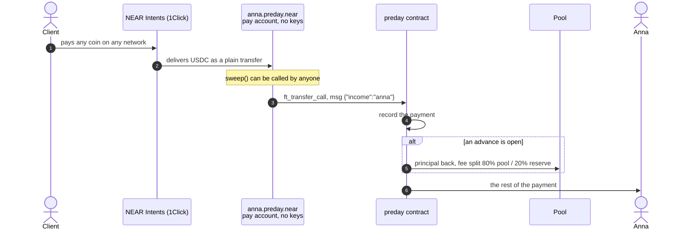
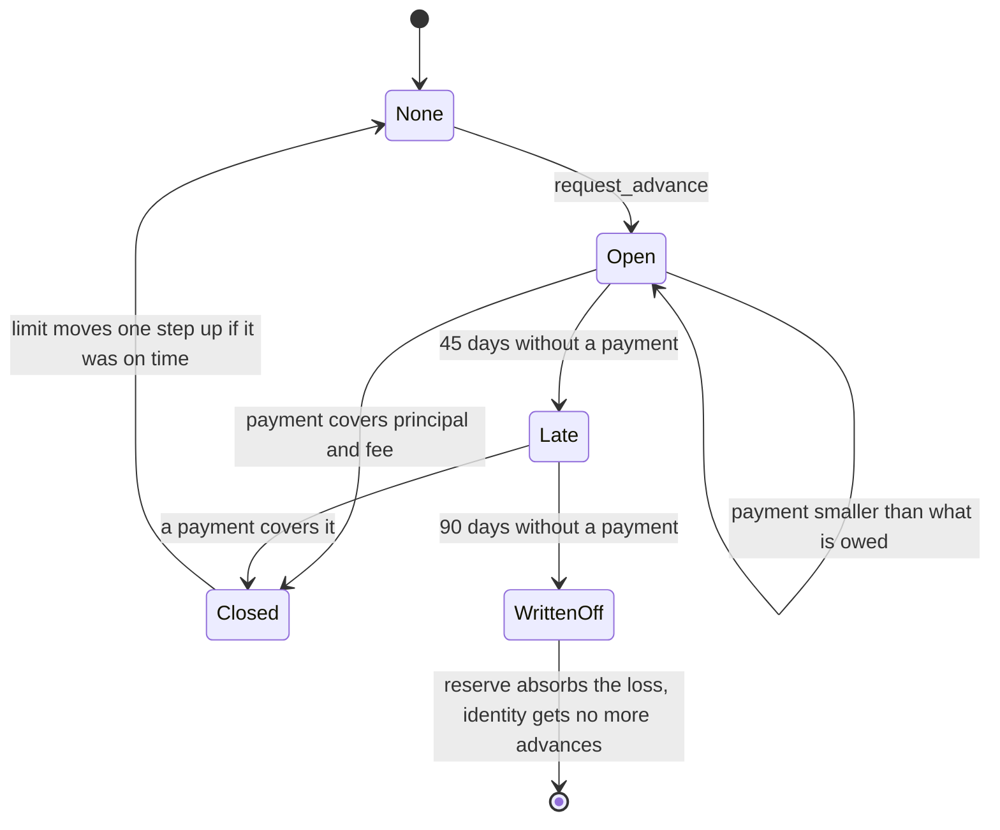
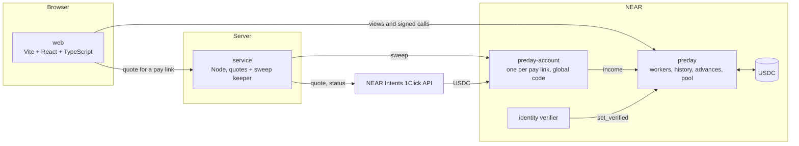

<div align="center">


# Preday

**Payday is whenever you need it.**

A pay link for people paid in crypto, with a paycheck advance that pays itself back.

[](https://github.com/0xNickdev/preday/actions/workflows/ci.yml)
[](https://preday.vercel.app/)
[](LICENSE)
[](https://testnet.nearblocks.io/address/preday-v1.testnet)
[](contracts)
[](#run-it)

[Live demo](https://preday.vercel.app/) · [Docs](https://preday.vercel.app/docs) · [Contract on testnet](https://testnet.nearblocks.io/address/preday-v1.testnet) · [How it works](#how-a-payment-moves) · [Run it](#run-it)

</div>

---

Built for **NEAR Hackathon**, track **Real-World Money**.

A freelancer claims `preday.app/anna` and sends it to clients instead of a wallet address. The client pays with any coin from any network. Dollars (USDC) arrive, the contract records the income, and after a few payments Anna can take part of her next payment early. When that payment lands, the contract takes the advance and a flat fee out of it and forwards the rest. Nobody has to remember to repay anything.

## Contents

- [Why](#why)
- [Try it in two minutes](#try-it-in-two-minutes)
- [How a payment moves](#how-a-payment-moves)
- [The life of an advance](#the-life-of-an-advance)
- [The rules](#the-rules)
- [Architecture](#architecture)
- [Contract interface](#contract-interface)
- [Run it](#run-it)
- [Status and limits](#status-and-limits)

## Why

Paycheck advance is a large business in regular fintech (Dave, EarnIn, Chime MyPay), and all of it runs through a bank account or an employer's payroll system. A contractor paid in stablecoins has neither, so none of it works for them.

| | Bank-based advance | Employer-based advance | Preday |
| --- | --- | --- | --- |
| Needs | A US bank account | An employer with payroll software | A pay link |
| Works for crypto income | No | No | Yes |
| How repayment is secured | Debit from the bank account | Payroll deduction | Income passes through the contract first |
| What the client has to do | Nothing | Integrate | Pay a link with any coin |

Preday gets the guarantee that makes this product work, repayment at the source, from a contract instead of a payroll integration.

## Try it in two minutes

Open the [demo](https://preday.vercel.app/). It creates a throwaway NEAR testnet account in your browser, so there is no wallet to install and no real money involved.

| Step | Do this | You see |
| :-: | --- | --- |
| 1 | Open the app, claim a name | Your dashboard and a pay link |
| 2 | Open the pay page, pay three times with test dollars | Three payments in the dashboard |
| 3 | Press "Verify identity", wait 2 minutes | "You can take up to $25 of it today" |
| 4 | Press "Get $25 now" and confirm | "Advance open: $26.25" |
| 5 | Pay the link once more | Advance closed, limit step moves from $25 to $50 |
| 6 | Open Pool | The $1.25 fee split: $1.00 to the pool, $0.25 to the reserve |

The demo deployment requires 2 minutes of payment history instead of 30 days. Everything else is the production rule set.

## How a payment moves



The pay account exists because an Intents payment arrives as a plain transfer with no memo. One account per person answers "whose money is this" without a trusted watcher. Each pay account has no access keys and runs shared code published once as a NEAR global contract, so it costs 0.001 NEAR and can do exactly one thing.

What NEAR does here:

- **Intents** let the client pay with what they hold. The worker never sees a bridge.
- **Named accounts** make a salary address readable, and global contracts make one per person cheap.
- **The contract** makes repayment at the source impossible to talk around, and makes income history public and checkable.

## The life of an advance



## The rules

All of these live in contract state and are returned by `get_params`. Changing them goes through a timelock.

| Rule | Value |
| --- | --- |
| Eligibility | 3 payments, 30 days since the first one, one identity check per person |
| Base | Median of the last 3 payments |
| Limit | The lower of 30% of the base and the current step |
| Counted payments | $10 or more. Smaller ones are still delivered, but do not build history or reset a late clock |
| Steps | $25, $50, $100, $200, $400. One step up for an advance repaid on time, if it was open at least 7 days and was at least half of the limit |
| Open advances | One at a time |
| Fee | 5% of the advance, $1 minimum, fixed when taken, collected at repayment |
| Repayment | From the next payment: principal, then fee, the rest to the worker |
| Short payment | Covers what it can. What is owed never grows |
| Late | 45 days without a payment: limit paused, back to the first step |
| Written off | 90 days: the reserve absorbs the loss, then the pool. That identity gets no more advances |
| Reserve | 20% of every fee |
| Pool utilization | At most 80% of pool assets out in advances |
| Pool withdrawals | 7 days after the backer's last deposit. The first $1 ever deposited stays locked |
| History kept | The last 20 events per pay link |

A 5% fee on a two-week advance is a high rate if you annualize it. The app shows the fee in dollars before the worker confirms and does not hide that.

## Architecture



| Path | What it is | Stack |
| --- | --- | --- |
| [`contracts/preday`](contracts/preday) | Main contract: workers, payment history, advances, the pool | Rust, near-sdk 5.30 |
| [`contracts/preday-account`](contracts/preday-account) | The pay account. One method: `sweep()` | Rust, 25.8 KB wasm |
| [`contracts/test-usdc`](contracts/test-usdc) | Testnet stand-in for USDC with an open mint | Rust |
| [`contracts/test-verifier`](contracts/test-verifier) | Testnet stand-in for an identity provider | Rust |
| [`web`](web) | Landing, pay page, dashboard, pool | Vite, React, TypeScript |
| [`service`](service) | 1Click quotes for a pay link, sweep after a payment succeeds | Node 24, no framework |
| [`scripts`](scripts) | Testnet deployment | Bash, near CLI |

## Contract interface

| Method | Who can call | What it does |
| --- | --- | --- |
| `register(handle)` | Anyone | Creates the keyless pay account `handle.<contract>` |
| `ft_on_transfer` | The USDC token | `{"income":"anna"}` from a pay account, `{"deposit":true}` from a pool backer |
| `request_advance(amount)` | A worker | Checks the limit, sends USDC to the worker |
| `withdraw(shares)` | A pool backer | Redeems pool shares |
| `claim()` | A worker | Collects a payout that could not be delivered earlier |
| `set_verified(handle, person_code)` | The identity verifier | One person, one handle |
| `mark_late(handle)`, `write_off(handle)` | Anyone, after the deadline | Moves a stale advance along |
| `propose_params`, `apply_params` | Owner proposes, anyone applies after the delay | Timelocked rule changes |

Views: `get_worker`, `get_handle`, `get_limit`, `get_activity`, `get_pool`, `get_shares`, `get_lp`, `get_params`, `get_pending_params`, `get_config`.

What the contract cannot do:

- The owner has no method that moves anyone's money.
- The owner cannot set rules that would let them drain the pool. Hard ceilings are compiled in: an advance is never more than 50% of a typical payment or $1,000, the fee never more than 10%, and rule changes always wait at least the timelock. An open advance keeps the deadlines it was taken with.
- A pay account has no keys. Only its code can act, and the code only forwards USDC to the main contract.
- Amounts are integers of USDC minimal units. There is no floating point anywhere.

## Run it

Needs Node 24+. The contracts also need Rust with the `wasm32-unknown-unknown` target and [cargo-near](https://github.com/near/cargo-near).

```bash
git clone https://github.com/0xNickdev/preday && cd preday

# 1. The whole story on testnet, printed step by step (about 3 minutes)
cd web && npm install
echo "VITE_CONTRACT_ID=preday-v1.testnet" > .env
npm run demo

# 2. The app
npm run dev            # http://localhost:5173

# 3. Contracts: 132 unit tests and 11 sandbox tests with real cross-contract calls
cd ../contracts
for crate in preday preday-account test-usdc test-verifier; do (cd $crate && cargo near build non-reproducible-wasm); done
cargo test --workspace

# 4. Payment service: 48 tests, plus dry quotes against the real 1Click API
cd ../service && npm install && npm test && npm run test:live
```

`npm run demo` ends with output like this:

```
6. Anna takes a $25 advance
   owes $25.00 + $1.25 fee, wallet: $3045.00
7. The next $1,000 payment arrives
   advance paid back, limit level 1, wallet: $4018.75
   pool: $501.00 assets, $0.25 reserve, $1.25 fees earned so far
```

To deploy your own copy:

```bash
scripts/deploy-testnet.sh my-preday      # creates my-preday.testnet and two helper accounts
echo "VITE_CONTRACT_ID=my-preday.testnet" > web/.env
```

Service configuration is described in [`service/.env.example`](service/.env.example). Keys only ever come from the environment.

## What we tried to break

Before submission the contracts went through an adversarial review whose only job was to find ways to steal or cheat. Each finding was reproduced as a test and then closed.

| Attack | Now |
| --- | --- |
| Owner raises the limit to the size of the pool, borrows it and defaults | Compiled-in ceilings on every rule that moves money, and a minimum timelock |
| Climb the limit ladder in minutes with tiny advances repaid from your own pocket | A step-up needs an advance that stayed open for the seasoning period and was at least half of the limit |
| Erase a debt by confusing two advances opened at the same moment | Every advance has its own number, and callbacks match on it |
| Send dust to someone's link to wreck their limit, or to your own to never go late | Payments under the minimum are delivered but not counted |
| Spam payments until the contract cannot pay for its storage | History is a fixed ring of 20 events, covered by the registration deposit |
| Inflate the share price against the next depositor | The first dollar deposited is locked for good, and deposits have a minimum |
| Add to the pool just before a repayment, take the fee, leave | Deposits are locked for the withdrawal delay |
| A total loss leaves the pool unusable | The pool starts a new share epoch and keeps working |

What this does not cover: the identity check is trusted completely, a person can still default once up to their limit, and a near-total loss leaves old shares almost worthless rather than reset.

## Status and limits

Started on 12 November 2026 for NEAR Hackathon. It is not connected to any earlier project.

| Area | State |
| --- | --- |
| Pay accounts on global code, no keys | Working on testnet |
| Income recording, limits, advances, repayment | Working on testnet |
| Partial repayment, late, write-off, timelock | Covered by sandbox tests |
| Pool, shares, reserve | Working on testnet |
| Browser flow without a wallet | Working, verified by hand |
| Service sweep after a payment | Verified on testnet: the keeper swept a pay account and the contract settled an open advance |
| Real coins through NEAR Intents | Service built, request format verified with dry quotes. No real payment routed yet |
| Identity check | Testnet stand-in that approves everyone |
| Wallet sign-in | Not built. The demo signs with a throwaway key kept in the browser |
| Security review | One internal adversarial pass. Every attack it found is now a regression test. No outside audit |

Stated plainly:

- **Mainnet.** NEAR Intents has no testnet, so on testnet a "payment" is test dollars minted to the pay account. From there it takes the same path through the contract.
- **Identity.** The contract stores only a hash and already enforces one person, one handle. A real provider plugs in as the `verifier` account.
- **Upgradability.** The demo contract account still holds a full-access key, so its code can be replaced. A production deployment would delete that key.
- **Cross-chain withdrawal fee** from the product plan is not implemented.

## License

[MIT](LICENSE)
